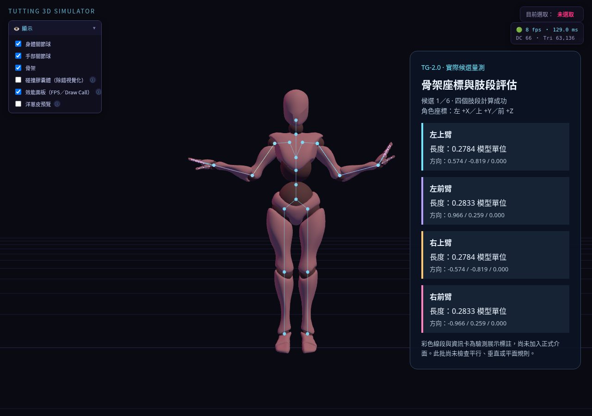

# TG-2.0 骨架座標與肢段評估

日期：2026-10-12 · [文件總覽](../README.md) · [Roadmap](../planning/Tutting_Pose_Generator_Roadmap.md)

## 實作範圍

`src/motion/tutting-geometry.js` 提供 `createTuttingGeometryEvaluator({model,bones,restQuat})`，呼叫 `evaluate(angles)` 可取得四個肢段的端點、長度及單位方向。Tutting 候選新增暫存 `geometry` 量測結果；原有角度搜尋、排序、預覽與套用規則保持不變。

肢段為 `lUpperArm`、`lForeArm`、`rUpperArm`、`rForeArm`。上臂端點為上臂骨根部至前臂骨根部；前臂為前臂骨根部至手骨根部。

## 座標契約

- 參考模型根節點；Xbot 的 +X 為角色左、+Y 為上、+Z 為前。
- 排除模型根節點及其外部祖先的位移、旋轉與縮放；模型內部的骨盆、脊椎與肩部動作保留。
- 長度與端點採模型局部單位，不能直接標成公尺。後續平面位置誤差可使用骨長正規化。
- 校準版本為 `xbot-model-root-v1`；不宣稱可自動校準其他角色骨架。

評估器複製節點變換與階層，不複製網格、材質或蒙皮，也不修改正式場景。映射關節使用 `restQuaternion × XYZ 角度增量`，與正式姿勢套用方式一致。每次評估需提供全部映射關節的有限三軸角度。

校準資料建立後不隨正式角色變動；更換骨架、骨骼偏移或 rest quaternion 後需重新建立評估器。生成器每次生成均重建校準，單次搜尋結果共用評估器。

## 失敗處理與保存

缺少模型、端點、rest quaternion 或骨骼不屬於模型時，建立評估器明確拋出校準錯誤。缺少有效角度、零長度肢段或非有限端點時，評估回傳 `ok:false` 與原因，不產生假方向。

生成器在校準失敗時保留 TG-1 行為，候選附帶 `invalid-calibration` 診斷；尚未聲稱候選符合幾何規則。量測資料為暫存候選資訊，不新增專案 schema、持久化設定或歷史項目，舊專案保持原有格式。

## 驗證

- 新增四項單元案例：端點與方向、上游／rest rotation、根節點與祖先變換不變性、錯誤資料。
- 四項直接單元測試通過；完整 `npm test` 的 21 個測試檔通過。當前 Node runner 以檔案彙報，21 不代表全部細項數量。
- `npm run build` 通過。
- 瀏覽器測試以 checksum 驗證的實際 Xbot fixture，比較 12 組包含脊椎、肩、上臂及前臂轉動的姿勢；檢查量測不修改正式骨骼、四肢段候選資料與原始／打包版本回歸。
- 原始版與打包版的完整瀏覽器回歸均通過，初始姿勢、候選肢段資料、拍點與取樣骨骼旋轉結果一致；沒有 JavaScript 錯誤或失敗請求。
- 每個版本各檢查 12 組 Xbot 姿勢，最大端點差異為 `4.578092683617719e-16` 模型局部單位；正式骨骼未被評估改動。此數值僅表示 FK 計算一致性，不代表姿勢符合尚未實作的幾何規則。
- 實際介面操作確認生成候選皆包含四個肢段資料，取消及恢復原專案正常；回歸另涵蓋既有生成器套用、Undo／Redo、JSON 匯入匯出與自動存檔重載。

## 尚未包含

本批沒有新增使用者幾何規則介面、平面／平行／垂直篩選、鏡像、碰撞、IK 固定或轉場全程驗證；下一批為 TG-2.1。未進行手機實機效能測試。此報告完成時尚未部署或推送；TG-2.0 與 TG-2.1 成果於本次發布一併納入。

## 展示附件

[單拍示範時間軸](../examples/tutting-geometry.timeline.json)

圖中彩色線段及右側資訊卡是驗測展示標註，不是 TG-2.0 正式介面。後續正式規則介面見 [TG-2.1 報告](tutting-rules-report.md)。
