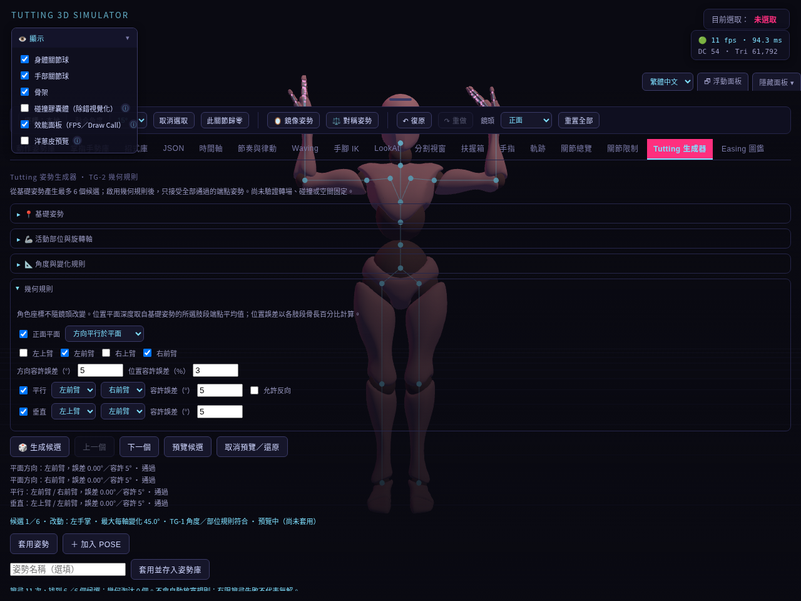
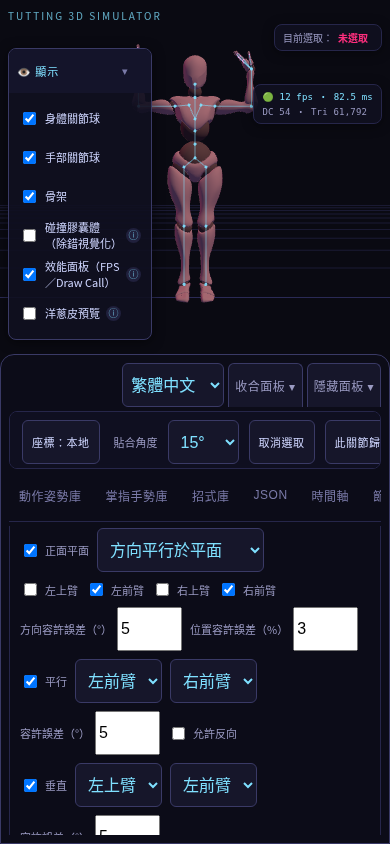
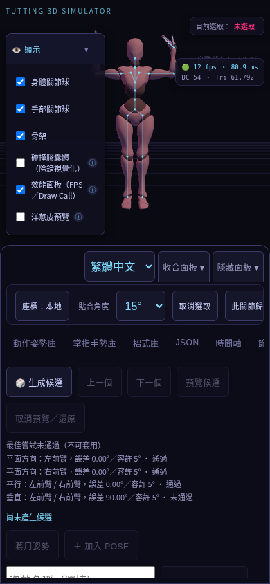

# TG-2.1 幾何規則實作與驗測報告

日期：2026-10-13 · [文件總覽](../README.md) · [Roadmap](../planning/Tutting_Pose_Generator_Roadmap.md)

## 實作成果

在「Tutting 生成器」加入幾何規則，控制左右上臂及前臂：

| 規則 | 設定 | 判定 |
| --- | --- | --- |
| 正面平面方向 | 選擇一至四個肢段、角度容許誤差 | 肢段方向偏離角色 XY 平面的角度 |
| 正面平面位置 | 選擇肢段、骨長百分比容許誤差 | 兩端距離固定平面的最大值，除以該肢段長度 |
| 平行 | 選擇不同的兩個肢段、允許反向、角度誤差 | 同向夾角，或允許反向時取最小平行偏差 |
| 垂直 | 選擇不同的兩個肢段、角度誤差 | 夾角距離 90° 的差 |

參考模型根節點座標：+X 角色左、+Y 上、+Z 前。位置平面的法向為 +Z；平面深度為基礎姿勢所有選定肢段端點 Z 值的平均值。平面固定於這個基礎參考，不以候選重新擷取。角度預設 5°、位置預設 3%，可由使用者調整。

生成流程先檢查 TG-1 的部位、活動軸、角度集合及關節限制，再檢查全部啟用的幾何規則。只有全部通過的候選可預覽、套用或加入 POSE；排序仍採總角度改動量，沒有用分數掩蓋失敗規則。

候選資訊逐條顯示肢段、實際誤差、容許值、單位及通過狀態。搜尋失敗時顯示最佳嘗試的規則結果與失敗狀態，套用按鈕停用；這份診斷不列為正式候選。

## 操作

1. 擺好姿勢並按「擷取目前姿勢」。
2. 選擇允許改動的關節／軸及角度集合。
3. 展開「幾何規則」，啟用需要的平面、平行或垂直條件。
4. 按「生成候選」，查看逐條誤差並切換預覽。
5. 確認後套用或加入 POSE；規則隨專案保存。

規則變更立即取消預覽並讓候選失效。空平面肢段、相同肢段配對及無效容許值會提示修正，不能沿用舊候選。套用前重新驗證幾何；校準失效時拒絕套用。

## 模組與資料

- `src/motion/tutting-rules.js`：規則設定清理、平面參考、角度／位置誤差與全部規則判定。
- `src/motion/tutting-generator.js`：可選幾何評估回呼、有限搜尋篩選及最佳失敗診斷。
- `src/motion/tutting-controller.js`：介面、預覽有效性、提交再驗證、歷史與快照整合。
- `src/i18n/tutting-messages.js`：新介面及動態結果的繁中／英文切換。

幾何設定位於 `tuttingGenerator.config.geometry`，規則版本為 1；頂層專案 schema 維持現有版本。舊專案缺少此欄位時全部規則預設關閉。候選、量測及失敗診斷維持暫存，不寫入專案；基礎姿勢與設定可重載。候選有效性包含設定、基礎、限制、演算法／校準版本及映射骨骼校準資料。

## 驗測

| 檢查 | 範圍 | 結果 |
| --- | --- | --- |
| 新增規則單元測試 | 同向／反向、90°、平面方向／位置、兩端點、骨長正規化、固定基礎深度、複合失敗、無效配對、舊設定、重現性及 2,000 次上限 | 5 項通過 |
| 全套單元測試 | `npm test`；當前 runner 以測試檔彙報，非細項數量 | 22 個測試檔通過 |
| 打包 | `npm run build` | 通過 |
| TG-2.1 瀏覽器 | 原始版／打包版；複合規則各 6 候選、seed 重現、取消、套用、姿勢歷史、位置平面、重載、英語、390px 排版、衝突、無效輸入及無活動軸 | 兩版通過；另驗證規則 Undo／Redo、實際 JSON 匯入及雙上臂移動的 2 個合格候選 |
| 完整瀏覽器回歸 | 模型、所有分頁、IK、扶握、生成器、歷史、資料庫、時間軸、音訊、JSON 及自動存檔 | 原始版與打包版皆通過，兩版結果一致 |

重現指令：`npm test`、`npm run build`、`CHROMIUM_PATH=/usr/bin/chromium npm run test:tutting`、`CHROMIUM_PATH=/usr/bin/chromium npm run test:browser`。瀏覽器使用 checksum 驗證的本機 Xbot fixture 及鎖定版本 Three.js；不依賴即時 CDN 可用性。

## 限制

- 每次最多嘗試 2,000 次並保留最先找到的最多 6 個合格候選，再排序；不是全域最佳搜尋。
- 搜尋使用離散角度集合。有限搜尋失敗不證明無解，程式不自動放寬條件。
- 搜尋目前同步執行；大型規則的效能、分批進度與取消操作留待 TG-2.3 評估。
- 僅檢查單一候選端點姿勢；未驗證插值轉場、左右鏡像、碰撞、IK 空間固定或人體平衡。
- 390px 測試是瀏覽器排版驗證，沒有手機實機效能驗證。此報告完成時尚未推送或部署；本次將程式、驗測資料、圖片及示範專案一併發布至 main。

## 測試附件與示範

[機器可讀驗測結果](tutting-rules-results.json) · [兩拍示範時間軸](../examples/tutting-rules.timeline.json)

示範檔可在「時間軸 → 匯入」讀取，包含基礎候選與雙上臂移動候選，以及啟用的生成規則。兩個端點通過規則，不代表轉場全程已驗證。

/index.html：成功案例 15 ms，衝突案例 1004 ms；/dist/index.html：成功案例 739 ms，衝突案例 471 ms。這些是本次雲端 Chromium 的操作回應時間，包含瀏覽器排程，不代表手機效能或單純求解耗時。兩版均無 JavaScript 錯誤，規則誤差一致。

### 桌面規則與逐條誤差

### 手機控制項

### 衝突規則診斷

