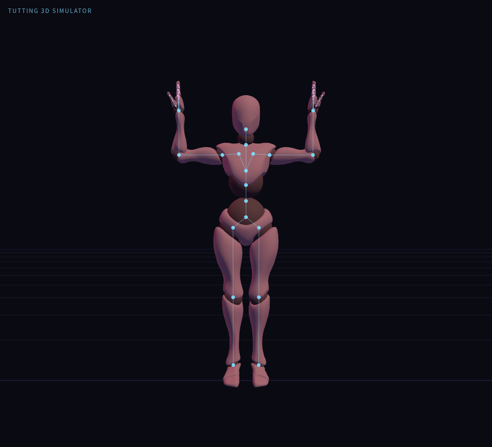

# 基礎直角框架

[姿勢 JSON](basic-right-angle-frame.pose.json) · [姿勢清單](README.md)

適用於本專案的 Xbot 角色，作為手臂直角與雙側框架練習的起始姿勢。

- 雙上臂向兩側展開，前臂向上，雙肘形成約 90°。
- 兩條前臂同向平行，雙手及手指使用模型的初始展開設定。
- 軀幹及下半身使用初始關節角度。

檔案包含完整 50 個關節的角度。左前臂為 `[0, 0, 90]`，右前臂為 `[0, 0, -90]`，其餘關節為 `[0, 0, 0]`；這些是相對 Xbot 初始骨骼方向的局部 XYZ 角度，不是世界空間方向。

## 讀取

複製 `.pose.json` 的內容，貼到模擬器「JSON」分頁並按「套用 JSON」。這是單一姿勢檔，不使用時間軸的「⬆ 編舞」匯入。

若目前正在播放或由 IK、FingerTut、扶握等功能控制手臂，請先停止或退出相關控制，再套用此基礎姿勢。

## 確認紀錄

已透過實際模擬器的 JSON 面板套用，再複製回讀確認 50 個關節資料一致，並使用 TG-2.0 肢段評估確認雙肘約 90°、前臂平行向上；預覽為實際 Xbot 渲染截圖，沒有修改應用程式碼。操作期間無 JavaScript 錯誤。
