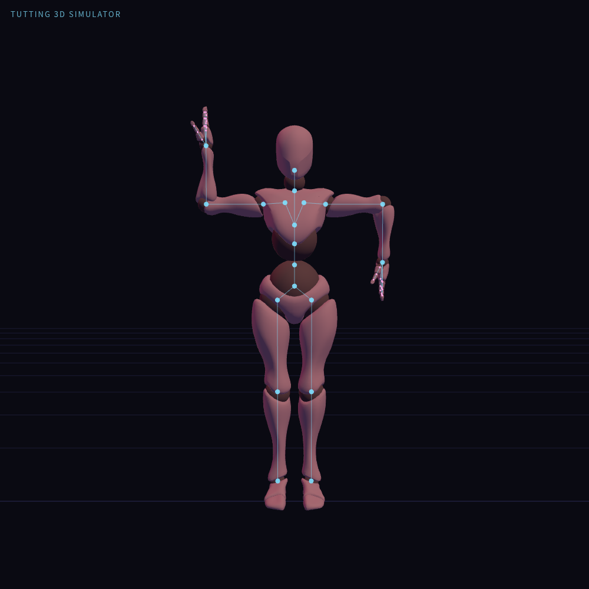
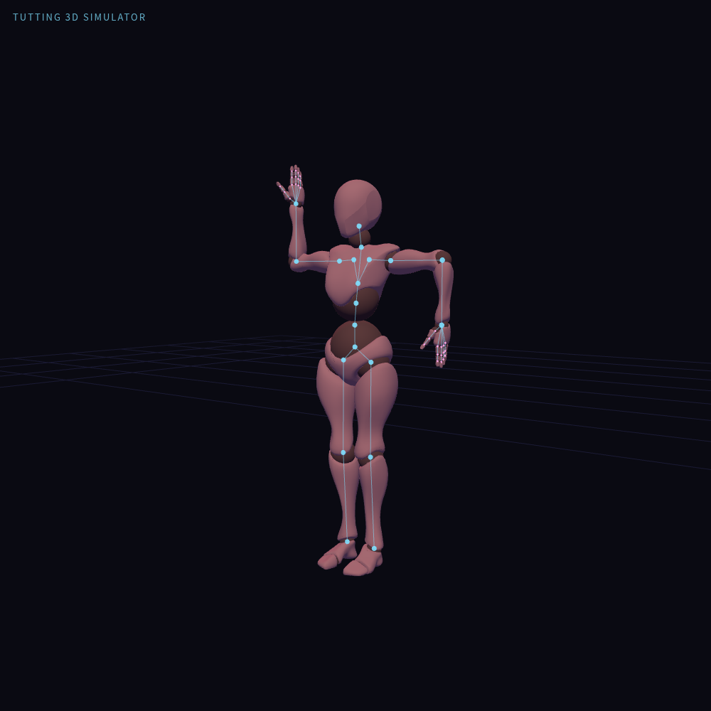

# 右高左低框架

[姿勢 JSON](right-high-left-low-frame.pose.json) · [姿勢清單](README.md)

角色右前臂向上、左前臂向下，可與左高右低框架交替練習。

左右以角色自身為準；面向角色觀看時，畫面左右與角色左右相反。

軀幹與下半身使用初始角度，手指使用模型的初始展開設定。此檔案適用於專案的 Xbot 模型，包含 50 個關節的局部 XYZ 角度，以 0.1° 記錄。

## 正面預覽

## 斜側預覽

## 讀取與確認

複製 `.pose.json` 內容到模擬器「JSON」分頁，按「套用 JSON」。這是單一姿勢，不使用時間軸的「⬆ 編舞」匯入。請先停止播放並解除會接管雙臂的 IK、FingerTut 或扶握控制。

已在實際模擬器套用並複製回讀，50 個關節資料一致；TG-2.0 評估確認雙肘約 90°，前臂方向符合上述配置。預覽為實際渲染截圖，操作期間無 JavaScript 錯誤。這份確認不包含動作轉場、碰撞或人體舒適度評估。
