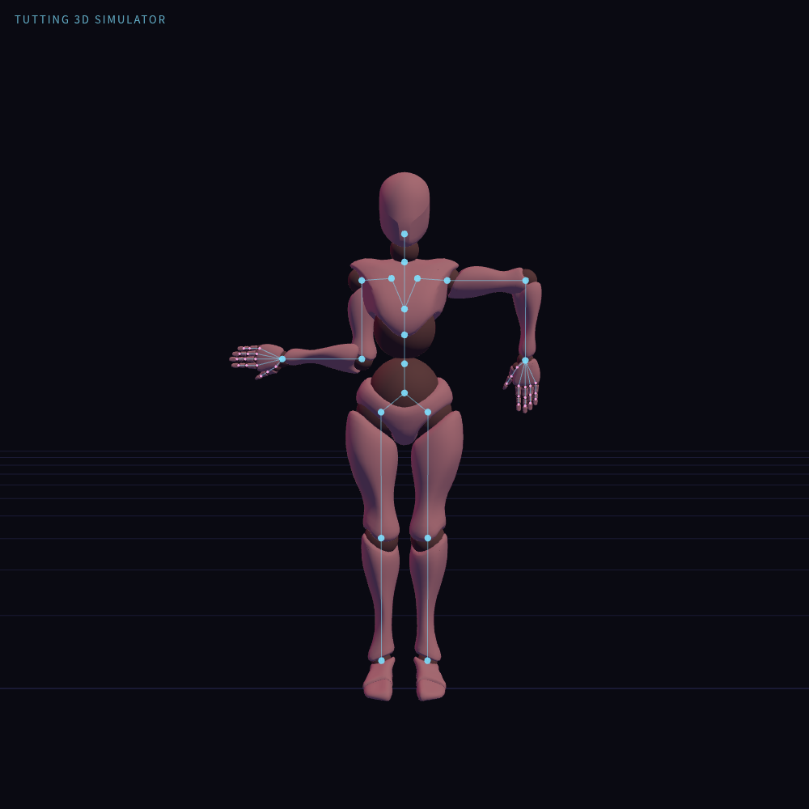
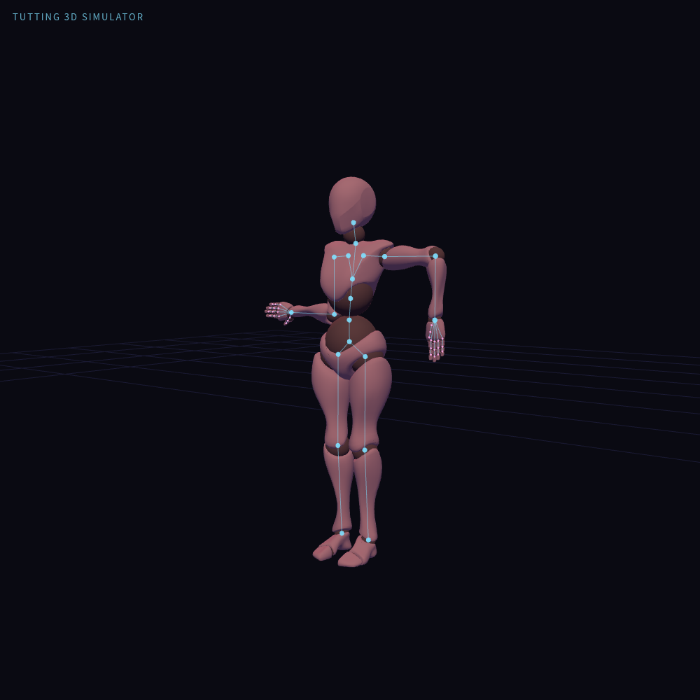

# 右橫左垂

[姿勢 JSON](right-horizontal-left-downward.pose.json) · [姿勢清單](README.md)

角色右前臂在低處水平向外延伸，左前臂向下，可與左橫右垂交替使用。

左右以角色自身為準；面對角色觀看時，畫面左右與角色左右相反。

掌面朝前，手指沿前臂方向展開；軀幹與下半身保持初始關節角度。適用於本專案的 Xbot 模型，檔案包含完整 50 個關節的局部 XYZ 角度，以 0.1° 記錄。

## 正面預覽

## 斜側預覽

## 讀取與確認

複製 `.pose.json` 內容至模擬器「JSON」分頁，按「套用 JSON」。這是單一姿勢，不使用時間軸的「⬆ 編舞」匯入。套用前請先停止播放，並解除會接管雙臂的 IK、FingerTut 或扶握控制。

已在實際模擬器套用並複製回讀，50 個關節資料一致；TG-2.0 評估確認雙肘約 90°，前臂方向符合說明。正面與斜側預覽為實際渲染截圖，操作期間無 JavaScript 錯誤；未驗證動作轉場、碰撞或人體舒適度。
