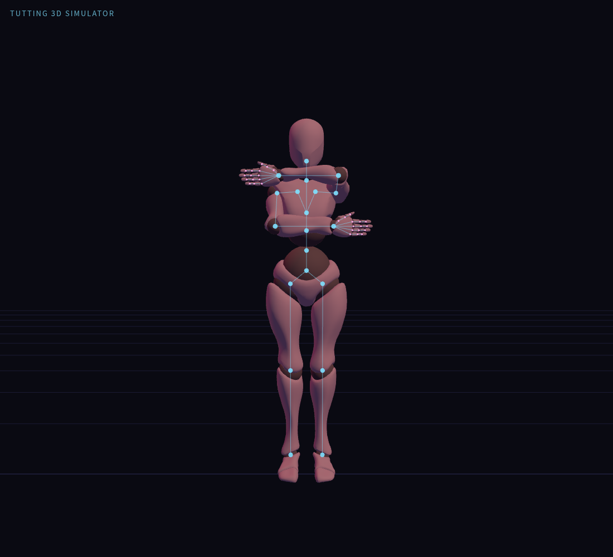

# 雙層橫向框架

[姿勢 JSON](stacked-horizontal-frame.pose.json) · [姿勢清單](README.md)

適用於本專案的 Xbot 角色，可與「基礎直角框架」交替練習，觀察垂直與水平手臂排列的差異。

- 左前臂位於較高位置，右前臂位於較低位置；左右以角色自身為準。
- 兩條前臂放在身體前方，水平且反向平行，手指沿前臂延伸方向展開。
- 雙肘在三維空間中約為 90°；上臂朝前延伸，因此正面投影不等同於側面的實際角度。
- 軀幹及下半身維持初始關節角度。

## 讀取

複製 `.pose.json` 內容到模擬器「JSON」分頁，按「套用 JSON」。檔案含完整 50 個關節的局部 XYZ 角度，以 0.1° 記錄；不包含鏡頭、身體整體變換或時間軸。

套用前請先停止播放，並解除會接管雙臂的 IK、FingerTut 或扶握控制。這是單一姿勢，不使用時間軸的「⬆ 編舞」匯入。

## 確認紀錄

使用實際 Xbot 骨架與既有兩節 IK 建立姿勢，再轉回局部角度。已以 JSON 面板套用並複製回讀，確認 50 個關節資料一致。TG-2.0 評估的左右肘角度約為 90°，前臂夾角約為 180°，且前臂方向接近角色水平軸。

預覽是實際模擬器渲染截圖；沒有修改應用程式碼，操作期間無 JavaScript 錯誤。
